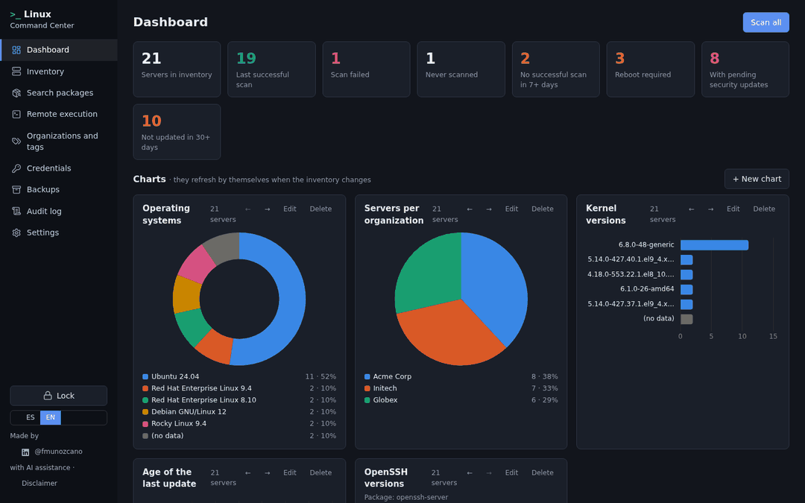
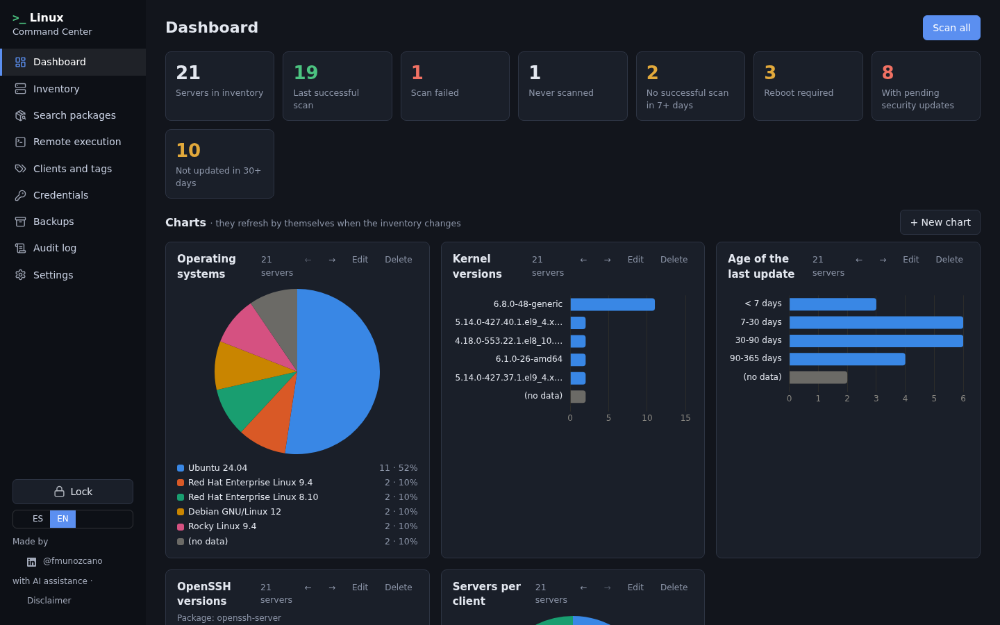
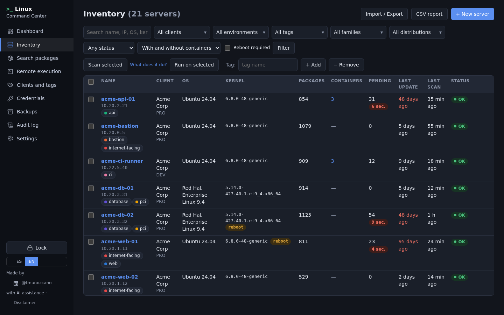
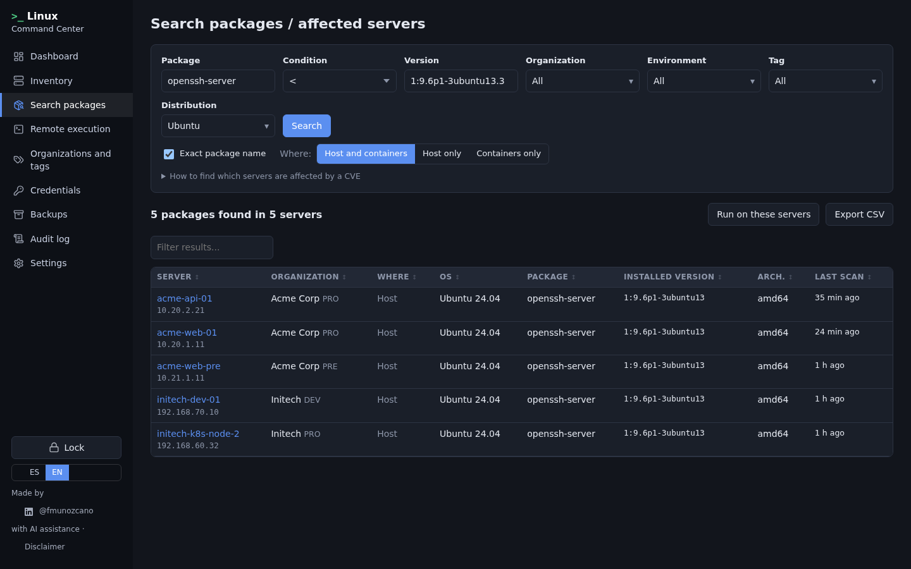
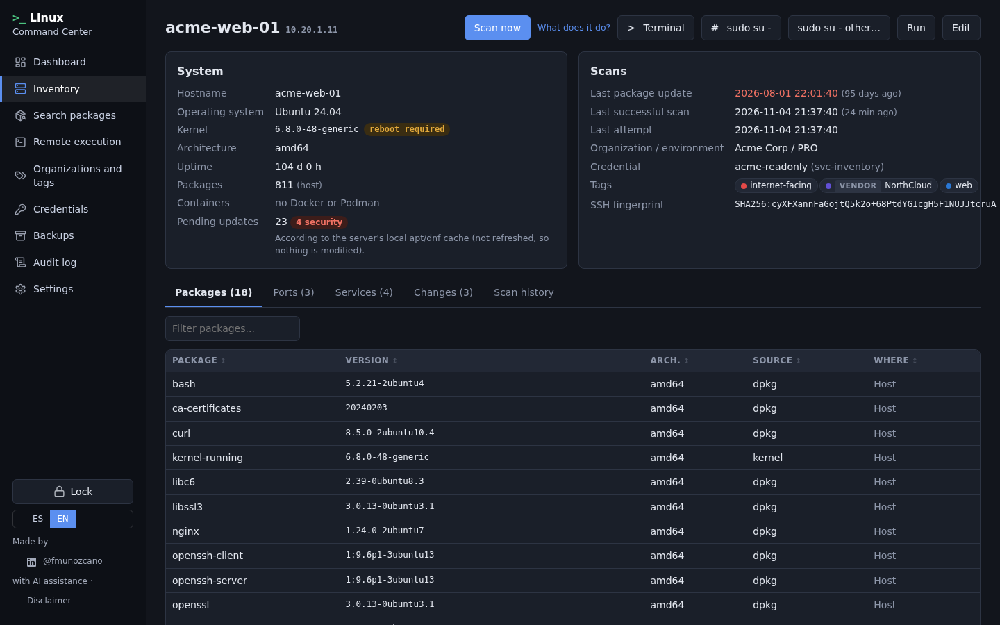
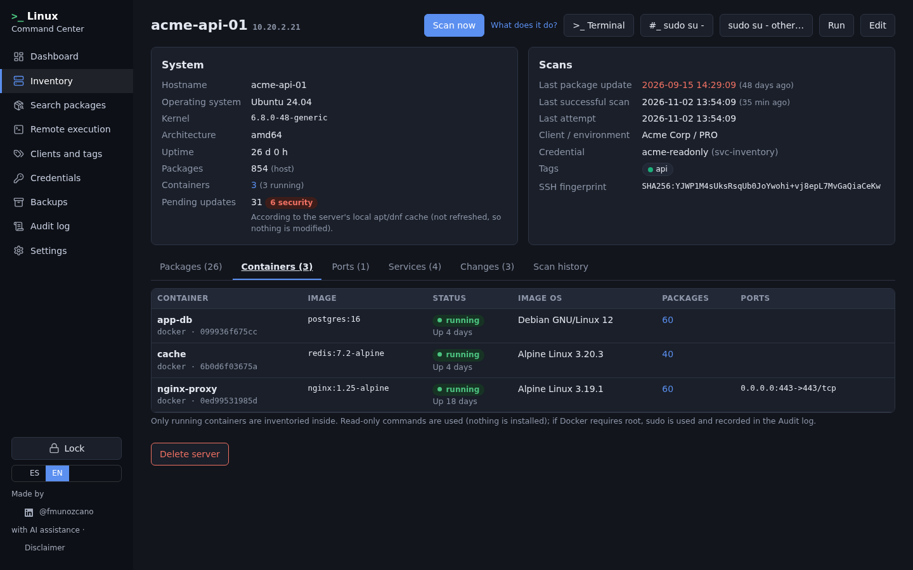
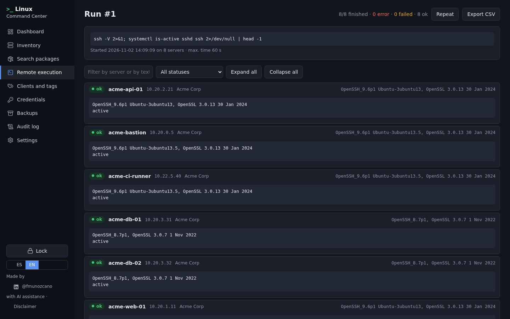

<div align="center">

# &gt;_ Linux Command Center

**Agentless Linux inventory and vulnerability triage over SSH. Built by a security analyst, for security analysts.**

*Which of my servers are affected by the CVE that dropped this morning?* Answer it in seconds, across every
organization, without installing anything on a single server.



</div>

---

## Why?

The last few weeks have brought a constant stream of critical vulnerabilities: PHP2Shell, Java, the Linux kernel,
the Brotli decoder, OpenSSL… Every time, the same questions come up: **which servers run the affected package, in
which version, and are they patched yet?**

Answering that across dozens of servers that belong to different organizations, behind different VPNs, usually
means SSH-ing into machines one by one or keeping spreadsheets that are out of date the day after.

Linux Command Center keeps a **centralized, up-to-date inventory** of your Linux servers (OS, kernel, every
installed package and its exact version, containers, pending updates) and lets you **search it like a
vulnerability scanner would**, using each distribution's own version-comparison rules. No agents and no changes
on the servers: it connects over SSH, reads, and disconnects.

## Highlights

- **Find affected servers in seconds.** Search by package and version (`<`, `<=`, `=`, `>=`, `>`) with real `rpm`
  and `dpkg` version comparison (epochs, backported releases such as `-27.el9_4` or `ubuntu13.5`). Filter by
  organization, environment, tag or distribution, then run a command on the results or export them.
- **Agentless, read-only inventory.** OS, kernel (running vs. installed), packages (dpkg / rpm / apk / snap),
  listening ports, running services, uptime, pending and security updates, last package update, reboot required.
- **Inside containers too.** Docker and Podman containers are listed and, when running, inventoried from the
  inside (Alpine, Debian, UBI…), so a vulnerable OpenSSL inside an image does not go unnoticed.
- **Version detection beyond packages.** Configurable probes (`nginx -v`, `java -version`, `openssl version`…)
  catch software installed by hand, in `/opt` or from tarballs.
- **Change tracking.** Every scan records what was installed, updated or removed since the previous one.
- **Remote execution at scale.** Run a command on many servers in parallel (with or without `sudo`), see the
  result per server, filter and export. Keep a personal library of reusable commands with `{{variables}}`.
- **Web terminal + SFTP.** A full terminal in the browser (also as `sudo su -`), with a side panel to browse,
  download and upload files over the same SSH connection.
- **Built for many organizations.** Organizations, environments and coloured tags, multi-select filters
  everywhere, and you can scan one organization at a time while you are on its VPN.
- **Dashboard and custom charts.** OS, kernels, package versions, patch age, containers… They refresh by
  themselves and every bar or slice links to the servers behind it.

## Security by design

This tool holds credentials to other people's servers, so it is built defensively:

| | |
|---|---|
| **Runs on your machine only** | The web UI is bound to `127.0.0.1`. No cloud, no telemetry, nothing "phones home". |
| **Nothing installed on servers** | Scans are read-only commands over SSH. The exact script is shown in the app (*Inventory → What does it do?*). |
| **Encrypted vault** | Credentials are encrypted with AES-256-GCM using a key derived from your master password (scrypt). By default **nothing is stored**: the app asks for credentials when it connects. |
| **Step-up authentication** | Opening a terminal, running remote commands, changing files over SSH or revealing a password asks for the master password again (valid for 5 minutes). |
| **Host-key verification** | The first SSH fingerprint of each server must be confirmed before any credential is sent (or imported from your `known_hosts`). A changed key blocks the connection. |
| **Safe mode** | `reboot`, `rm -rf /`, `mkfs`, firewall flushes, stopping `sshd`, package installs, `docker rm`/`prune`… require typing **CONFIRM**, both in remote execution and in the terminal. |
| **Tamper-evident audit log** | Every login, terminal, command and credential access is recorded in a hash chain signed with a secret key. You can verify it from the UI, export it as JSONL and forward it to a SIEM via syslog. |
| **Hardened container** | Read-only filesystem, non-root user, all Linux capabilities dropped, `no-new-privileges`, memory and PID limits. The app locks itself after 15 minutes of inactivity. |
| **Jump hosts** | Servers that can only be reached through a bastion connect through it (like `ssh -J`), verifying both host keys. |

## Screenshots

| Dashboard | Inventory |
|---|---|
|  |  |
| **Search: affected servers** | **Server details** |
|  |  |
| **Containers inventoried from the inside** | **Remote execution** |
|  |  |

<sub>All data in the screenshots is fictitious.</sub>

## Installation

You only need **Docker**. The image is built on your own computer from the code in this repository, so what runs
is exactly what you can read here.

### Windows

1. Install **[Docker Desktop](https://www.docker.com/products/docker-desktop/)** (it uses WSL 2) and start it.
   Wait until it shows *Engine running*.
2. Get the code, either:
   - **Code → Download ZIP** on this page and extract it, or
   - with Git: `git clone https://github.com/K1kuK0nK4/linux-command-center.git`
3. Open a terminal in that folder (in Explorer: right-click the folder → *Open in Terminal*, or use the terminal
   built into Docker Desktop) and run:

   ```powershell
   docker compose up -d --build
   ```

4. Open **http://localhost:8080** and create your master password.

From then on the container appears in Docker Desktop under **Containers → linux-command-center**, where you can
start it, stop it or view its logs with one click. It starts automatically together with Docker Desktop.

### Linux (and macOS)

Install Docker Engine with the Compose plugin ([instructions](https://docs.docker.com/engine/install/)), or
Docker Desktop on macOS, then:

```bash
git clone https://github.com/K1kuK0nK4/linux-command-center.git
cd linux-command-center
docker compose up -d --build
```

Open **http://localhost:8080** and create your master password.

### Updating

```bash
git pull
docker compose up -d --build
```

(Or download the new ZIP and run the same command in its folder.) Your data is kept: it lives in the Docker volume
`linux-command-center-data`, not in the project folder.

## Getting started

1. **Create the master password.** It encrypts everything and cannot be recovered, so keep it in your password
   manager.
2. **Add a server** (*Inventory → New server*), or import many at once from Excel/CSV
   (*Inventory → Import / Export*, a template is provided).
3. Connect the organization's VPN and press **Scan**. On first contact, confirm the server's SSH fingerprint.
4. **Search** a package and version, e.g. `openssh-server` `<` `1:9.6p1-3ubuntu13.3` filtered by *Ubuntu*.

> **Tip for CVEs:** distributions backport fixes without changing the upstream version. Always compare against the
> *vendor's* fixed version (Red Hat, Ubuntu and Debian security trackers), one search per distribution.

## What it runs on your servers

The scan only uses read-only commands, without `sudo`: `cat /etc/os-release`, `uname`, `dpkg-query -W` / `rpm -qa`
/ `apk info`, `apt list --upgradable` / `dnf -C check-update` (local cache only, nothing is downloaded), `ss -tuln`,
`systemctl list-units`, the version probes you enable, and `docker`/`podman ps` plus a read-only `exec` for
containers (with `sudo` only if Docker requires it, and recorded in the audit log).

On the server side it looks like a normal SSH login and a few commands. Make sure you are **authorised** to access
every system you add.

## Roadmap

- [ ] **CVE search.** Type a CVE ID and get the fixed version per distribution (Red Hat Security Data, Ubuntu CVE
      Tracker, OSV.dev) and the list of affected servers, with no static data inside the app.
- [ ] **Actively exploited flag.** Highlight vulnerabilities listed in the CISA KEV catalog.
- [ ] **End-of-life detection.** Warn about operating systems without security support (endoflife.date).
- [ ] **AI-assisted triage.** Summarise an advisory and suggest the searches and remediation commands.
- [ ] **Hardening checks.** A read-only baseline (SSH configuration, sudoers, SELinux/AppArmor, firewall, time
      sync…) with a score per server.
- [ ] **Access review.** Users with a shell, sudo rights and `authorized_keys` fingerprints.
- [ ] **Change alerts.** New listening ports, users or services since the last scan.
- [ ] **Reports.** Per-organization PDF/Excel reports: unpatched servers, EOL systems, hardening status.

Ideas and feedback are welcome in [Issues](https://github.com/K1kuK0nK4/linux-command-center/issues).

## Tech stack

Python 3.12 · FastAPI · asyncssh · SQLite · Jinja2 templates with plain JavaScript · xterm.js · Chart.js ·
Lucide icons. Everything, including the front-end libraries, is bundled: no CDN is loaded at runtime.

## About

Created by **[@fmunozcano](https://www.linkedin.com/in/fmunozcano/)**, a cybersecurity analyst (not a professional
software developer) with the help of AI, to make day-to-day vulnerability triage faster. If it saves you time, a
star on the repository is the best way to say so.

> **Disclaimer.** This software is provided "as is", without warranty of any kind. Use it only on systems you are
> explicitly authorised to access, and in accordance with your organisation's and your clients' policies. The full
> legal notice is shown when the application starts.

## License

[MIT + Commons Clause](LICENSE): free to use, modify and share (including at work), but **you may not sell it** or
offer a paid product or service whose value derives substantially from it. Bundled third-party components keep
their own licenses (xterm.js and Chart.js: MIT; Lucide: ISC).
